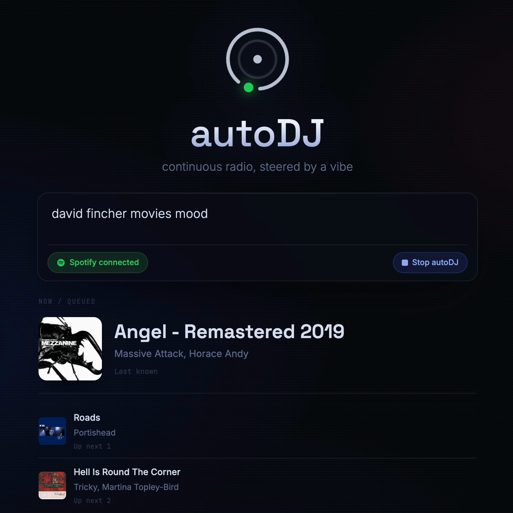

# autoDJ



autoDJ is a fun weekend project for exploring the OpenAI API and LLM-assisted content curation through a tiny Spotify radio controller. Give it a vibe, connect Spotify, and it keeps a live queue moving with track ideas selected by a language model.

The project is intentionally small: a single-page interface, a PHP runtime, Spotify playback controls, and a token-efficient queue strategy. Instead of asking the model for one track at a time, autoDJ asks for a compact batch of candidate search queries, stores that candidate pool, and spends it across later queue ticks.

## Features

- Vibe-based radio sessions for continuous Spotify playback.
- LLM-generated candidate pools for token-efficient curation.
- Spotify queue monitoring, playback takeover, and duplicate avoidance.
- Minimal glassy control panel with current track and upcoming queue.
- Session guardrails that stop the queue when the control page or playback goes inactive.

## Local Run

```bash
php -S 127.0.0.1:8000 -t autoDJ
```

Open `http://127.0.0.1:8000`. The UI loads without external build tooling. The API runtime expects local configuration values before Spotify and OpenAI actions are available.

## Repo Structure

```text
autoDJ/                 public web app
autoDJ/api/             browser-facing PHP endpoints
autoDJ_private/         runtime helpers and CLI tick entrypoint
autoDJ.gif              interface preview
```

## Status

Weekend-project quality: useful, opinionated, and compact. The interesting part is the queue strategy: keep model calls sparse, keep responses structured, and let deterministic Spotify search and duplicate checks do as much work as possible.

## License

MIT
